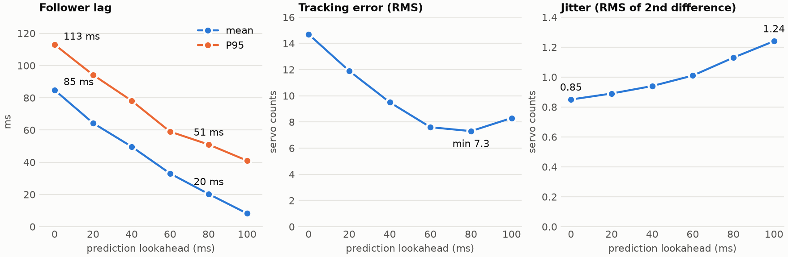
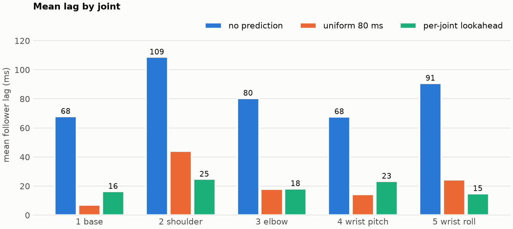

# nexarm-teleop-latency

Measuring and reducing latency in leader–follower teleoperation of a NexArm
6-DOF bus-servo arm, with the PC in the loop: read the leader, process, write
the follower, all timestamped on one clock.

**Status:** work in progress. The driver, measurement tools and a first
compensation result are done. See [what is not done yet](#limitations-and-open-items).

## Result so far

Without compensation the follower trails the commanded trajectory by about
84 ms on average. Linear feedforward prediction brings that to about 20 ms.

| Configuration | Mean lag | P95 lag | Tracking error (RMS) | Jitter (RMS) |
|---|---|---|---|---|
| No prediction | 84.2 ms | 116.0 ms | 27.8 counts | 1.58 counts |
| Uniform 80 ms lookahead | 21.9 ms | 56.0 ms | 12.8 counts | 1.87 counts |
| Per-joint lookahead | 19.4 ms | 50.0 ms | 12.1 counts | 1.87 counts |

Joints 1–5 pooled, 366 two-second windows per row, three replays of the same
40 s recorded trajectory. One count is 1/4096 of a revolution. Conditions and
caveats are below; they matter.



Lag falls roughly linearly with lookahead. Tracking error bottoms out near
80 ms and rises again at 100 ms, where the prediction overshoots; jitter rises
throughout. That puts the useful range at 60–80 ms. (This sweep is from a
different, 27.5 s trajectory: six settings, three replays each.)



Joints differ: the shoulder is the slowest at 109 ms, the base and wrist pitch
the fastest at 68 ms. A single lookahead leaves a 37 ms spread between joints;
per-joint values cut it to 10 ms.

## Where the delay is

| Segment | Measured |
|---|---|
| Read leader (6 joints, one request) | 13.8 ms mean, 14.1 ms P95 |
| PC processing (leader reply to command written) | about 0.08 ms |
| Read follower (6 joints, bridge mode) | 4.6 ms mean, 4.8 ms P95 |
| Follower execution, 10° step: first motion / 50% / 90% | 31–48 ms / 72–114 ms / 113–174 ms |

The servo's own response dominates. That is why filtering alone cannot help
here (it only adds delay) and prediction can.


The leader read is slow because its firmware polls the six servos one at a
time with a fixed wait after each. With one leader read and one follower read
per cycle the loop tops out near 54 Hz; the experiments run at 50 Hz.

## How it works

```
leader arm ──USB──▶ PC ──USB──▶ follower arm
 (ESP32)            │            (ESP32 + AT32 co-processor)
                    ├─ read 6 joint positions          t_request, t_reply
                    ├─ map leader → follower
                    ├─ predict: x + v · lookahead      (optional)
                    ├─ clamp step per cycle
                    ├─ write 6 joint positions         t_write
                    └─ read follower positions back    t_request, t_reply
```

Both arms speak a framed serial protocol at 1 Mbps. The follower is switched
into a bridge mode in which its ESP32 forwards position reads and writes to
the servo bus. Every send and receive is stamped with `time.perf_counter_ns()`.

**Measuring lag.** A hand on the leader is not repeatable, so a recorded leader
trajectory is replayed as a virtual leader. Lag is the time shift that best
aligns the commanded trajectory with the follower's measured position, fitted
per two-second window to get a distribution. Negative lags are allowed, so
over-prediction shows up instead of being clipped at zero.

**Prediction.** Velocity is a low-passed finite difference (5 Hz cutoff), and
the command is the position extrapolated by the lookahead, with a cap on the
lead.

## Repository layout

| Path | Contents |
|---|---|
| [nexarm_teleop/protocol.py](nexarm_teleop/protocol.py) | Frame build and parse, leader-to-follower mapping |
| [nexarm_teleop/driver.py](nexarm_teleop/driver.py) | Serial driver with timestamps on every transfer |
| [nexarm_teleop/predictor.py](nexarm_teleop/predictor.py) | Linear feedforward prediction, per-joint lookahead |
| [nexarm_teleop/latency.py](nexarm_teleop/latency.py) | Time-shift lag estimation, stale-reading detection |
| [scripts/](scripts/) | Hardware checks, teleoperation, step response, replay, analysis, figures |
| [tests/](tests/) | Unit tests that need no hardware |
| [results/](results/) | Summary tables behind the numbers above |
| [docs/roadmap.md](docs/roadmap.md) | Plan and the full measurement log, including dead ends (Chinese) |

## Running it

Needs Python 3.12, a NexArm leader and follower on USB, and membership of the
`dialout` group.

```bash
python3 -m venv .venv
.venv/bin/pip install numpy matplotlib pyserial pytest

.venv/bin/python -m pytest tests                 # no hardware needed

.venv/bin/python scripts/probe_ports.py          # read-only: which port is which
.venv/bin/python scripts/check_bridge.py         # read-only: read timing on both arms
.venv/bin/python scripts/teleop.py --duration 40 # teleoperate and record a trajectory
.venv/bin/python scripts/step_response.py        # follower step response
.venv/bin/python scripts/replay.py results/logs/teleop_XXXX.csv --lookahead 80
.venv/bin/python scripts/replay.py results/logs/teleop_XXXX.csv --lookahead 65 110 80 65 95 0
.venv/bin/python scripts/analyze_replay.py results/logs/batch2/replay_la*.csv
.venv/bin/python scripts/make_figures.py
```

Port paths are set in [nexarm_teleop/\_\_init\_\_.py](nexarm_teleop/__init__.py)
and are specific to one machine: the two boards have identical USB-serial
chips with no serial number, so they are told apart by USB port.

The follower must not be in its wireless (ESP-NOW) sync mode while the PC is
driving it, or the two command sources fight.

**Safety.** The follower moves under program control. Keep its workspace
clear. The scripts refuse to start if leader and follower poses differ too
much, ramp in over a few seconds, limit the step per cycle, and the step test
aborts if a joint stops short of its target.

## Test conditions

- Control rate 50 Hz (achieved 50.0 Hz in every replay, no timeouts).
- Servo motion parameters: acceleration 100, speed limit 2000 (the vendor
  defaults). On a 10° step these made no measurable difference.
- No payload. Arm clear of the table.
- Trajectories are hand-dragged leader motion, replayed: peak joint speed about
  130–200 °/s.
- Lag is fitted on two-second windows with a one-second hop, keeping windows
  with at least 80 counts of motion.
- Timestamps for a position are the midpoint of its request and reply.

## Limitations and open items

- **The lag excludes the leader read.** Replay bypasses the real leader, so
  about 14 ms of acquisition is not in the numbers above.
- **No external ground truth yet.** Positions are read back over the same
  serial link whose delay is being measured. A high-speed video check is
  planned.
- **Moderate motion only.** No fast moves or hard stops, and overshoot is not
  measured separately.
- **The gripper is not compensated.** Its lag is about 140 ms and is set by
  rate limiting, not by anything prediction can fix: the leader gripper maps
  to the follower with a gain of 4.
- **The follower sometimes returns a stale reading** for joint 2 (the same
  value for several cycles, then a jump faster than the servo's speed limit).
  These samples are detected and dropped from the analysis.
- **Per-joint lookahead values were set by hand** from one measurement, not
  searched.
- Not done: porting the input filters, comparing control rates, and the
  compatibility write-up for the stock LeRobot SO-101 driver.

## Background

This applies a measure-then-compensate method used earlier on a different
pair of arms (an Alicia-D leader driving a FAIRINO FR3 over `ServoJ`,
[leader-follower-teleop](https://github.com/lfulai223-wq/leader-follower-teleop)).
The hardware, the protocol and where the delay sits are all different here,
so nothing was carried over as a number; everything above was measured on
NexArm.
